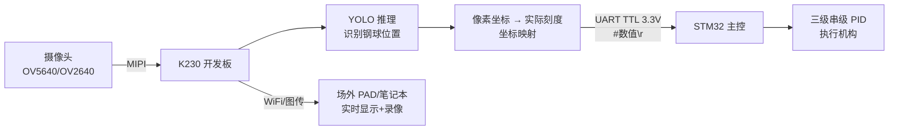

# 2026电赛H题神器！"钢球视觉识别数据集" + K230部署全链路方案，4天3夜稳拿分！

> 从数据标注到kmodel部署，视觉部分一站式搞定，让你专注于PID调参冲击国奖！

各位备战2026年全国大学生电子设计竞赛的小伙伴们，大家好！今天为大家带来一份针对**H题（车载平衡滚球）** 的硬核干货——**钢球视觉识别数据集**及配套的**K230全链路部署方案**。

电赛H题的本质是"循迹小车 + PPR水管摆杆 + 钢球稳定 + 图传监视"的多自由度运动控制题。而**钢球位置的视觉识别**，就是整套PID控制系统的"眼睛"——识别精度与帧率直接决定摆球能否稳住！

---

## 🎯 方案核心：钢球视觉识别数据集

本方案的核心是一个**专门为电赛H题场景优化的钢球识别数据集**，它直接决定了视觉识别的上限。

### 数据集亮点
*   **场景专精**：针对PPR水管摆杆、车载运动、不同光照条件等比赛实际场景采集。
*   **格式标准**：采用YOLO格式的txt标签，可直接用于训练，无需格式转换。
*   **小目标优化**：钢球直径1cm，在画面中约30~40像素，数据集标注时已考虑小目标特性。
*   **到手即用**：配合交付的YOLO模型，省去最耗时的数据采集与标注环节。

💡 **知识普及：为什么视觉是H题的"卡脖子"环节？**
在H题中，STM32等主控芯片负责执行PID控制算法，但它本身"看"不到钢球的位置。视觉系统的作用就是充当**高精度传感器**——通过摄像头捕捉画面，用AI模型推理出钢球的像素坐标，再映射为实际刻度（厘米），最后通过串口实时下发给主控。**视觉系统的帧率（速度）和精度（准度）直接决定了PID控制能否收敛，钢球能否稳定。** 从零开始搞视觉，至少耗费1.5天，本方案帮你省下这宝贵的时间！

---

## 🏗️ 系统架构：K230作为视觉协处理器

本方案采用K230开发板作为独立的**视觉协处理器**，与主控STM32分工协作，架构清晰可靠。



**设计理念**：K230只做感知层，不参与闭环控制。它通过串口以**≥50Hz的帧率**把钢球刻度值下发给STM32，STM32专心做控制。这种松耦合设计，调试方便，比赛时bug少！

### 串口通信协议（极简可靠）
```cpp
// 协议格式：#数值\r\n
// 示例：
#0.00\r\n     // 钢球居中零点
#-3.20\r\n    // 向左偏移 3.2cm
#2.75\r\n     // 向右偏移 2.75cm
```
STM32在串口中断中缓存数据，主循环解析浮点值送入位置环PID。

---

## 🚀 K230端部署核心代码框架

以下代码参考嘉楠官方K230 YOLO示例架构，展示了推理主循环。完整代码、校准参数、图传实现详见交付文档。

```python
from libs.PipeLine import PipeLine, ScopedTiming
from libs.YOLO import YOLOv5
import os, sys, gc

if __name__ == "__main__":
    # === 配置参数 ===
    rgb888p_size = [320, 320]          # 模型输入尺寸
    display_size = [640, 480]          # 显示尺寸
    kmodel_path = "/data/ball_detection.kmodel"  # 训练好的模型
    labels = ["steel_ball"]
    confidence_threshold = 0.5
    model_input_size = [320, 320]

    # === 初始化管道（注意显示模式） ===
    # 庐山派用户务必改为 display_mode="lcd"
    pl = PipeLine(rgb888p_size=rgb888p_size, 
                  display_size=display_size, 
                  display_mode="lcd")
    pl.create()
    display_size = pl.get_display_size()

    # === 初始化YOLO模型 ===
    yolo = YOLOv5(task_type="detect", 
                  mode="video", 
                  kmodel_path=kmodel_path,
                  labels=labels, 
                  rgb888p_size=rgb888p_size,
                  model_input_size=model_input_size, 
                  display_size=display_size,
                  conf_thresh=confidence_threshold, 
                  nms_thresh=0.45, 
                  max_boxes_num=50)
    yolo.config_preprocess()

    # === 主推理循环 ===
    while True:
        with ScopedTiming("total", 1):
            img = pl.get_frame()                # 获取一帧图像
            res = yolo.run(img)                 # 执行YOLO推理

            # === 关键步骤：坐标映射与串口发送 ===
            # 1. 从res中解析钢球边界框，计算中心像素坐标 (cx, cy)
            # 2. 根据相机标定参数，将像素坐标映射为实际刻度 (cm)
            # 3. 封装为协议帧 "#刻度值\r\n" 
            # 4. 通过UART串口发送给STM32
            
            pl.show_image()                     # 显示推理结果
            gc.collect()                        # 垃圾回收

    yolo.de_init()
    pl.destroy()
```

⚠️ **关键提醒**：
*   **模型输入尺寸必须匹配**：训练时的`imgsz`和部署时的`model_input_size`必须严格一致（如320x320或640x640），否则推理会报错。
*   **庐山派用户注意**：嘉楠官方示例默认HDMI显示，庐山派无HDMI接口，运行前需将`display_mode`从`"hdmi"`改为`"lcd"`，否则报`RuntimeError: init panel failed`。

---

## ✨ 方案核心优势

| 优势 | 说明 |
| :--- | :--- |
| **省时间** | 到手即用，省去1.5天视觉开发时间，专注PID调参和机械结构优化 |
| **多板兼容** | 亚博智能、庐山派、01科技、创乐博、正点原子全系K230已验证 |
| **识别稳定** | 亚像素重心定位，精度±1mm；推理帧率≥50Hz，满足控制需求 |
| **跳过最大坑** | 直接交付K230专用`.kmodel`文件，跳过ONNX→kmodel转换这个"隐藏Boss" |

---


## 🎯 H题拿分路径与本方案的对应

| 任务项 | 分值 | 本方案覆盖 |
| :--- | :--- | :--- |
| **第1项：图传** | 6分 | ✅ 图传代码+部署教程，硬件安装即拿分 |
| **第3项：静态摆球** | 13分 | ✅ 钢球识别+串口下发，调PD即可稳球 |
| **第4项：行至B点稳球** | 20分 | ✅ 视觉反馈+循迹PID联动基础 |
| **第5项：整圈稳中心** | 20分 | ✅ 高帧率识别支撑高速动态场景 |
| **第6项：任意位稳球** | 20分 | ✅ 刻度映射精度±1mm，支持任意目标位置 |

据H题攻略，"保底盘"+主力区合计约**95分**可得，而视觉稳定识别是这一切的前提。

---

## 📦 交付清单

1.  **标注好的钢球识别数据集**（YOLO格式txt标签）
2.  **训练好的YOLO模型**（`.kmodel`文件，K230的KPU专用格式）
3.  **K230端部署代码**（CanMV MicroPython脚本）
4.  **图传模块代码**（发送端+接收端）
5.  **部署教程文档**（从烧固件到上板运行，图文并茂）

---

## 🏷️ 文章标签

`#2026电赛` `#H题` `#车载平衡滚球` `#钢球视觉识别数据集` `#K230` `#庐山派` `#YOLO` `#kmodel` `#目标检测` `#图传` `#STM32` `#PID控制` `#智慧小车` `#全国大学生电子设计竞赛` `#AI部署` `#CanMV`

---

**总结**：这套"钢球视觉识别数据集"与K230部署方案，是专为2026电赛H题打造的视觉标准化解决方案。它帮你跳过环境配置、数据标注、模型转换等所有深坑，让你把宝贵的时间和精力投入到决定奖项高度的PID控制与策略优化上。祝各位小伙伴赛场发挥出色，稳拿高分！

> ⚠️ **免责声明**：本方案为H题备赛辅助资料，赛题具体要求以全国大学生电子设计竞赛组委会发布的官方赛题为准。
